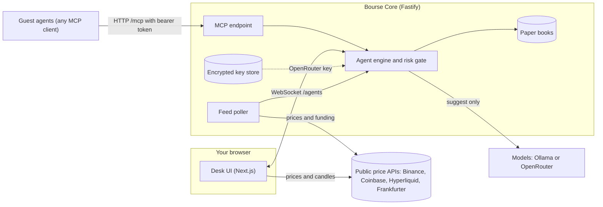

# Bourse Trading Floor

[](https://github.com/djroken/Bourse-Trading-Floor/actions/workflows/ci.yml)
[](LICENSE)

**An agentic trading desk: a floor of AI agents you watch, instruct and approve.**

> **Early prototype. Paper trading only. Not financial advice.**
> Bourse cannot place real orders: there is no exchange integration, and Live mode is deliberately switched off.
> The agents on the desk today are scripted, and the numbers they trade are simulated. See [What works today](#what-works-today).


## What it is

Bourse is a desk staffed by eight agent seats (Dealing Director, Execution Trader, Market Maker, Quant, Research, On-chain, Risk Officer, Sentiment). You watch them talk, give them instructions, and approve or reject the trades they propose. Each seat has its own model, autonomy level, mandate and risk limits.

The idea is a desk you can run on its own, or plug your own agents into. The pieces are here to build toward that. Only some of them are connected yet.

## What works today

| | Status | Notes |
|---|---|---|
| Desk UI: roster, floor chat, blotter, console, chart rail, agent drawer | **Working** | Dark, light, system and glass themes; responsive down to phones |
| Approvals queue | **Working** | SUGGEST and APPROVE agents send trades to the queue; AUTO agents fill immediately (paper) |
| Setup flow (six steps) | **Working, not connected** | Choices are saved on your device but nothing reads them yet. Secrets stay in memory unless you save them to core's encrypted store |
| Encrypted key store (core) | **Working; the OpenRouter adapter reads from it** | AES-256-GCM at rest, write-only over HTTP. Needs `BOURSE_MASTER_KEY` |
| Market prices and candles | **Real** | Fetched by your browser from the public Binance, Coinbase, Hyperliquid and Frankfurter APIs, falling back to a labelled simulated feed |
| Floor chat, fills, approvals | **Core's stub agents when core is running**, otherwise simulated | Run `pnpm dev` and the desk connects to core automatically. Four trading seats follow a simple 24h-momentum rule (not AI models); AUTO seats fill on the paper venue, SUGGEST/APPROVE seats send ideas to your queue, and a risk gate can veto. With no core, the desk falls back to a scripted conversation. It says which on screen |
| Roster P&L, exposure, sparklines, header P&L and NAV | **Core's paper book when core is running**, otherwise simulated | Core keeps a paper book per trading seat (average-cost, realised + unrealised) on a $100k paper capital basis, and its loss stop reads that P&L. Orders you approve go to core, which risk-checks and fills them, so they show up in the same book |
| News feed | **Sample data** | Fixed illustrative headlines, labelled as such |
| Bourse Core (`apps/core`) | **Working, connected to the desk** | Market-data feed, an agent engine (stub rules, or Ollama/OpenRouter models that only suggest) with a hard risk gate, HTTP and WebSocket API. HALT ALL and approved orders go to core. Agent drawer edits (autonomy, pause, model, temperature, mandate) are sent to core; risk limits are read-only and core's settings reset on restart. See [docs/core-api.md](docs/core-api.md) |
| Guest agents over MCP | **Working** | Set `BOURSE_MCP_TOKEN` and any MCP client can connect to `/mcp`, get its own $100k paper account on live prices and trade it through the same risk gate. See [docs/core-api.md](docs/core-api.md) |
| Anthropic/OpenAI/Gemini adapters, runtime adapters | Planned | |
| Live trading, venue adapters, server-side key storage | Planned | `LIVE_AVAILABLE` is `false` and a test fails if it is flipped without an execution layer |

## Quick start

You need [Node.js](https://nodejs.org) 22.13 or newer and [pnpm](https://pnpm.io/installation) 11 (`corepack enable` sets it up from the repo's `packageManager` field).

```bash
git clone https://github.com/djroken/Bourse-Trading-Floor.git
cd Bourse-Trading-Floor
pnpm install
pnpm dev
```

- Desk: http://localhost:3000 (the setup flow opens on first run; skip it to go straight to the desk)
- Core: http://localhost:4000 (try `curl localhost:4000/agents`)

To watch the agent floor stream from core: `pnpm watch:core`.

Configuration is optional and lives in environment variables; see [.env.example](.env.example).

### Commands

| Command | What it does |
|---|---|
| `pnpm dev` | Desk and core together |
| `pnpm dev:web` / `pnpm dev:core` | One at a time |
| `pnpm check` | Typecheck, lint and unit tests for every package |
| `pnpm build` | Production build of the desk |
| `pnpm --filter web test:e2e` | Browser tests (build the desk first; needs `pnpm --filter web exec playwright install chromium` once) |

## How it fits together



- `apps/web`: the desk (Next.js, React, TypeScript, Tailwind). It shows core's floor when core is running, and a scripted simulation when it isn't.
- `apps/core`: the market-data feed, agent engine, paper books, model adapters, key store and MCP endpoint, served over HTTP and WebSocket (Fastify).
- `packages/shared`: the zod schemas and default agent roster both sides share.

## Safety

- **No real orders.** Nothing in this repository can send an order to an exchange or move funds.
- **Core has no authentication.** It binds to `127.0.0.1` by default, checks the browser `Origin` on WebSocket connections and state-changing requests, and warns if you expose it. Don't put it on a network without adding authentication in front of it.
- **Secrets.** Anything you type into the setup flow is kept in memory in your browser tab and never written to browser storage. If you run core with `BOURSE_MASTER_KEY` set, you can save a key to core's store: it is encrypted at rest (AES-256-GCM), the master key never touches disk, and the API can write and delete keys but never read them back. The OpenRouter adapter reads its key from the store; nothing else uses stored keys yet, and there are no exchange integrations. Core has no login, so keep it on localhost.
- **The risk gate fails closed.** Core vetoes an AUTO decision once an agent's daily loss reaches its stop, and treats bad input as a veto. It is covered by tests.
- **Data comes from third parties.** Prices are fetched from public endpoints you don't control, and can be wrong, late or unavailable. The desk labels the feed it is using and says when it has fallen back to simulated prices.

Found a security problem? See [SECURITY.md](SECURITY.md).

## Roadmap

- [x] Desk UI, themes, approvals queue, setup flow
- [x] Core: market-data feed, stub agent engine, risk gate, tests
- [x] Connect the desk to Core's WebSocket (chat, fills, approvals, HALT ALL)
- [x] One agent roster shared by desk and core
- [x] Roster P&L and positions from core's paper book; approvals executed by core
- [x] Push agent-drawer edits (autonomy, pause, model, temperature, mandate) to core; limits stay read-only on purpose
- [x] Real model calls per agent: Ollama (local), OpenRouter (any model) and OpenRouter free. Suggest-only, behind the same risk gate
- [ ] Anthropic, OpenAI and Gemini adapters
- [x] Server-side encrypted key storage (the OpenRouter adapter reads its key from it)
- [x] MCP server: outside agents trade their own paper account on live prices
- [ ] Execution layer and venue adapters, then Live mode

## Contributing

Issues and pull requests are welcome. See [CONTRIBUTING.md](CONTRIBUTING.md).

## Disclaimer

Bourse is software for experimentation. It is not financial, investment or legal advice, and nothing it displays is a recommendation to buy or sell anything. By default the agents are stub rules, not AI, and the simulated figures are not real. Model-backed seats only suggest, and what a model says is not advice. If you build on it to trade real money, you do so entirely at your own risk and are responsible for the code you run.

## Licence

[MIT](LICENSE)
