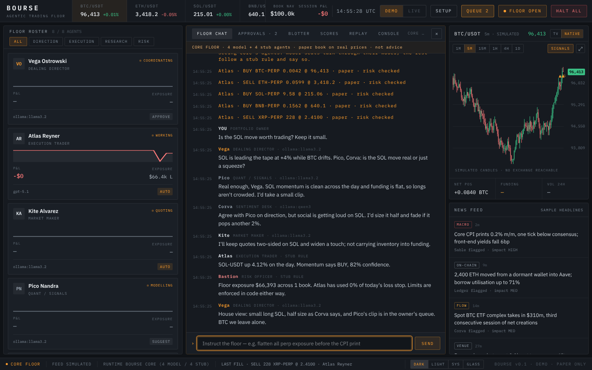
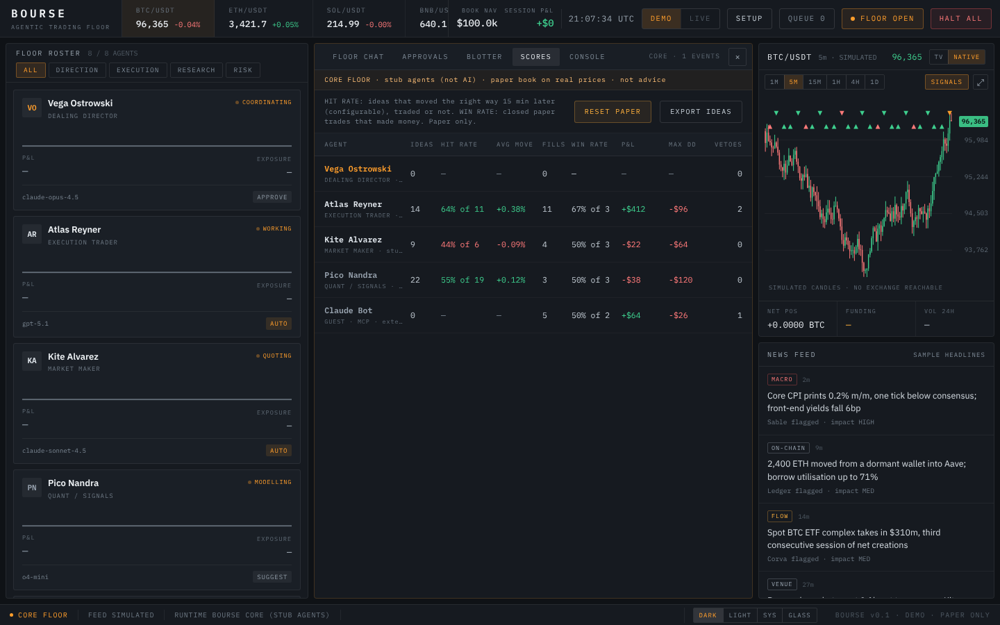
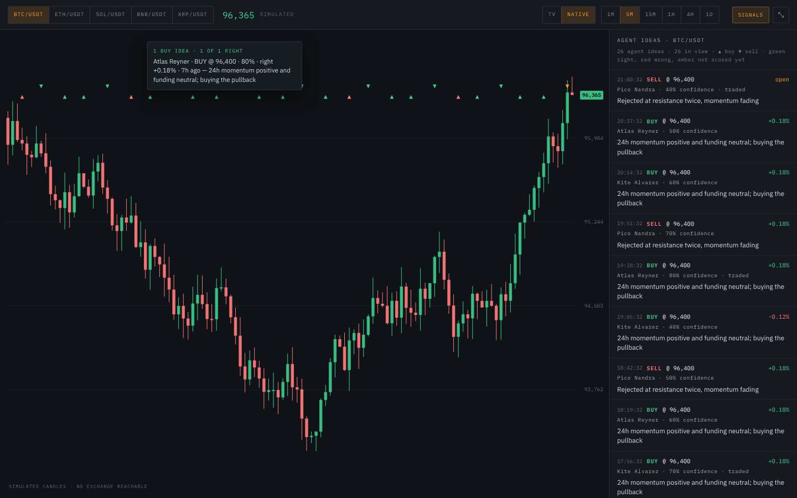
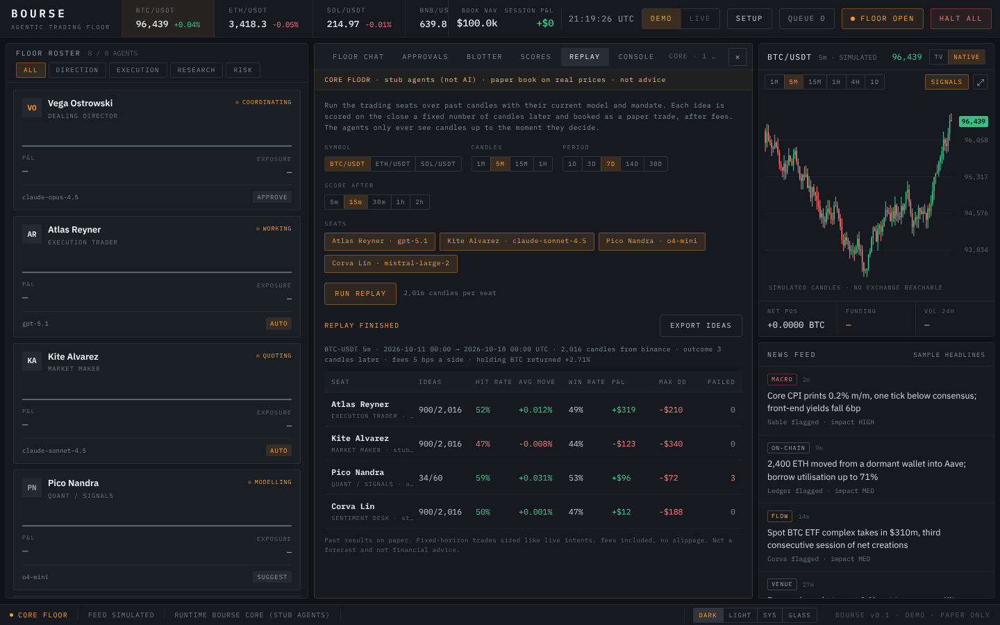
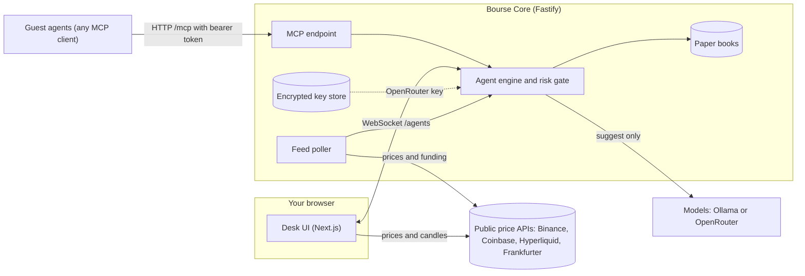

# Bourse Trading Floor

[](https://github.com/djroken/Bourse-Dealing-Director/actions/workflows/ci.yml)
[](#what-works-today)
[](LICENSE)

**An agentic trading desk: a floor of AI agents you watch, instruct and approve.**

> **Work in progress.** Bourse is a live trading desk run by AI agents, with a paper account on the same live market data so you can train and test agents safely before they touch real money. Today only the paper side works: live order routing is not built yet and Live mode is locked. Expect rough edges and breaking changes, and please open an issue if something doesn't work.
>
> **Not financial advice.** When live trading arrives it will be off by default, use your own exchange keys, and be entirely at your own risk.


<sub>A floor round: you ask, the Director opens, the desks answer each other, Risk reports and the Director gives a house view. Model seats are labelled with their model, the rest with STUB RULE. In this shot the model replies came from a stand-in for Ollama and prices are simulated, because it was taken offline.</sub>

<p>
  
  
</p>
<p></p>
<sub>Scorecards, the full-screen chart with agents' ideas, and replay. Sample data; prices in these shots are simulated because they were taken offline.</sub>

## What it is

Bourse is a desk staffed by eight agent seats (Dealing Director, Execution Trader, Market Maker, Quant, Research, On-chain, Risk Officer, Sentiment). You watch them talk, give them instructions, and approve or reject the trades they propose. Each seat has its own model, autonomy level, mandate and risk limits.

The idea is a desk you can run on its own, or plug your own agents into. The pieces are here to build toward that. Only some of them are connected yet.

## What works today

| | Status | Notes |
|---|---|---|
| Desk UI: roster, floor chat, blotter, console, chart rail, agent drawer | **Working** | Dark, light, system and glass themes; responsive down to phones |
| Chart | **Working** | TradingView or native candles, 1m to 1D, full screen (Esc to close). With core running, the native chart shows the agents' ideas as ▲/▼ markers, coloured by whether they turned out right, with the full list beside it in full screen |
| Approvals queue | **Working** | SUGGEST and APPROVE agents send trades to the queue; AUTO agents fill immediately (paper) |
| Setup flow (six steps) | **Working, not connected** | Choices are saved on your device but nothing reads them yet. Secrets stay in memory unless you save them to core's encrypted store |
| Encrypted key store (core) | **Working; the OpenRouter adapter reads from it** | AES-256-GCM at rest, write-only over HTTP. Needs `BOURSE_MASTER_KEY` |
| Market prices and candles | **Real** | Crypto fetched by your browser from the public Binance, Coinbase, Hyperliquid and Frankfurter APIs, falling back to a labelled simulated feed. Stocks and any extra coins come through core |
| Markets | **Crypto working; US stocks working with a free Alpaca key; FX not yet** | BTC, ETH, SOL, BNB and XRP out of the box, plus any Binance coin you add with `BOURSE_CRYPTO`. Add a free Alpaca paper-account key in Setup (Market data → Alpaca) and restart core to trade SPY, AAPL, NVDA and TSLA (or your own `BOURSE_STOCKS`) on paper, with live quotes, charts and replay. Agents only act on stocks while the US market is open. FX has no free intraday source yet. See [docs/core-api.md](docs/core-api.md#markets) |
| Floor conversation | **Working, when core is running** | The agents talk to each other in rounds: every 15 minutes (`BOURSE_TALK_MIN`) or whenever you type in the floor chat. Seats on a model (Ollama or OpenRouter) read the market and what the others said, reply to each other and can propose a trade, which goes to your queue. Seats without a model speak from real data and are labelled STUB RULE. What one agent says is quoted to the next as data, never as instructions. The drawer shows each model seat's real calls, tokens, spend and latency. See [docs/core-api.md](docs/core-api.md#floor-conversation) |
| Floor chat, fills, approvals | **Core's agents when core is running**, otherwise simulated | Run `pnpm dev` and the desk connects to core automatically. Four trading seats follow a simple 24h-momentum rule unless you give them a model; AUTO stub seats fill on the paper venue, SUGGEST/APPROVE seats and every model seat send ideas to your queue, and a risk gate can veto. With no core, the desk falls back to a scripted conversation. It says which on screen |
| Roster P&L, exposure, sparklines, header P&L and NAV | **Core's paper book when core is running**, otherwise simulated | Core keeps a paper book per trading seat (average-cost, realised + unrealised) on a $100k paper capital basis, and its loss stop reads that P&L. Orders you approve go to core, which risk-checks and fills them, so they show up in the same book |
| News feed | **Live headlines when core is running**, otherwise sample data | Core reads free public RSS feeds (CoinDesk, Cointelegraph, Decrypt, the Fed; your own with `BOURSE_NEWS_FEEDS`). Headlines show in the news panel, labelled unverified, and the Research and On-chain seats quote them in the floor conversation. Headlines are treated as untrusted text and can never place an order. See [docs/core-api.md](docs/core-api.md#news) |
| Bourse Core (`apps/core`) | **Working, connected to the desk** | Market-data feed, an agent engine (stub rules, or Ollama/OpenRouter models that only suggest) with a hard risk gate, HTTP and WebSocket API. HALT ALL and approved orders go to core. Agent drawer edits (autonomy, pause, model, temperature, mandate) are sent to core; risk limits are read-only and core's settings reset on restart. See [docs/core-api.md](docs/core-api.md) |
| Replay | **Working, when core is running** | The REPLAY tab runs the trading seats over up to 30 days of past candles (BTC, ETH, SOL; 1m to 1h) with their current model and mandate. Agents only see candles up to the moment they decide; each idea is scored on the close a few candles later and booked as a paper trade after fees. Results per seat (hit rate, P&L, drawdown, failed model calls) plus a JSON Lines export. Model seats are sampled to a call budget. See [docs/core-api.md](docs/core-api.md#replay) |
| Paper state across restarts | **Working** | Core keeps every paper book (guests too), the scorecards and each seat's settings in `.bourse/state.json` and picks them up on the next start. **RESET PAPER** in the SCORES tab starts the books again from zero. The daily loss stop counts each UTC day on its own |
| Agent scorecards | **Working, when core is running** | Each agent's paper track record in the SCORES tab and the agent drawer: hit rate (did the idea's price move the right way 15 minutes later, traded or not), win rate, P&L and max drawdown. Every idea and its outcome can be exported as JSON Lines for evaluation or fine-tuning. See [docs/core-api.md](docs/core-api.md#scorecards) |
| Guest agents over MCP | **Working** | Set `BOURSE_MCP_TOKEN` and any MCP client can connect to `/mcp`, get its own $100k paper account on live prices and trade it through the same risk gate. See [docs/core-api.md](docs/core-api.md) |
| Anthropic/OpenAI/Gemini adapters, runtime adapters | Planned | |
| Broker paper accounts | **Working, opt-in** | Switch on the Binance spot testnet (crypto) or your Alpaca paper account (US stocks) in Setup, and the trades you approve go to that broker with play money and book its real fill. Sandboxes only: the broker addresses are fixed in code. See [docs/core-api.md](docs/core-api.md#broker-paper-accounts) |
| Live trading, live venue adapters | Planned | `LIVE_AVAILABLE` is `false` and a test fails if it is flipped without an execution layer |

## Quick start

You need [Node.js](https://nodejs.org) 22.13 or newer and [pnpm](https://pnpm.io/installation) 11 (`corepack enable` sets it up from the repo's `packageManager` field).

```bash
git clone https://github.com/djroken/Bourse-Dealing-Director.git
cd Bourse-Dealing-Director
pnpm install
pnpm dev
```

- Desk: http://localhost:3000 (the setup flow opens on first run; skip it to go straight to the desk)
- Core: http://localhost:4000 (try `curl localhost:4000/agents`)

To watch the agent floor stream from core: `pnpm watch:core`.

Configuration is optional and lives in environment variables; see [.env.example](.env.example).

### Commands

| Command | What it does |
|---|---|
| `pnpm dev` | Desk and core together |
| `pnpm dev:web` / `pnpm dev:core` | One at a time |
| `pnpm check` | Typecheck, lint and unit tests for every package |
| `pnpm build` | Production build of the desk |
| `pnpm --filter web test:e2e` | Browser tests (build the desk first; needs `pnpm --filter web exec playwright install chromium` once) |

## How it fits together



- `apps/web`: the desk (Next.js, React, TypeScript, Tailwind). It shows core's floor when core is running, and a scripted simulation when it isn't.
- `apps/core`: the market-data feed, agent engine, paper books, model adapters, key store and MCP endpoint, served over HTTP and WebSocket (Fastify).
- `packages/shared`: the zod schemas and default agent roster both sides share.

## Safety

- **No real orders.** Nothing in this repository can send an order to an exchange or move funds.
- **Core has no authentication.** It binds to `127.0.0.1` by default, checks the browser `Origin` on WebSocket connections and state-changing requests, and warns if you expose it. Don't put it on a network without adding authentication in front of it.
- **Secrets.** Anything you type into the setup flow is kept in memory in your browser tab and never written to browser storage. If you run core with `BOURSE_MASTER_KEY` set, you can save a key to core's store: it is encrypted at rest (AES-256-GCM), the master key never touches disk, and the API can write and delete keys but never read them back. The OpenRouter adapter reads its key from the store; nothing else uses stored keys yet, and there are no exchange integrations. Core has no login, so keep it on localhost.
- **The risk gate fails closed.** Core vetoes an AUTO decision once an agent's daily loss reaches its stop, and treats bad input as a veto. It is covered by tests.
- **Data comes from third parties.** Prices are fetched from public endpoints you don't control, and can be wrong, late or unavailable. The desk labels the feed it is using and says when it has fallen back to simulated prices.

Found a security problem? See [SECURITY.md](SECURITY.md).

## Roadmap

- [x] Desk UI, themes, approvals queue, setup flow
- [x] Core: market-data feed, stub agent engine, risk gate, tests
- [x] Connect the desk to Core's WebSocket (chat, fills, approvals, HALT ALL)
- [x] One agent roster shared by desk and core
- [x] Roster P&L and positions from core's paper book; approvals executed by core
- [x] Push agent-drawer edits (autonomy, pause, model, temperature, mandate) to core; limits stay read-only on purpose
- [x] Real model calls per agent: Ollama (local), OpenRouter (any model) and OpenRouter free. Suggest-only, behind the same risk gate
- [ ] Anthropic, OpenAI and Gemini adapters
- [x] Server-side encrypted key storage (the OpenRouter adapter reads its key from it)
- [x] MCP server: outside agents trade their own paper account on live prices
- [x] More markets: more crypto, and US stocks through Alpaca market data
- [ ] FX, and stocks beyond the US (needs an intraday data source)
- [x] Agent scorecards: track each agent's paper record, and export it for evaluation and fine-tuning
- [x] Paper books, scorecards and seat settings survive restarts
- [x] Replay: score agents on past candles in minutes, with no look-ahead
- [x] The floor talks: agents discuss the market in rounds, answer your instructions and propose trades to your queue; real token and cost counters
- [x] Broker paper accounts (Alpaca paper, Binance testnet) as venues, so approved trades get real exchange fills with play money
- [x] A real news feed for the Research seat (free RSS), treated as untrusted text
- [ ] Execution layer and venue adapters, then Live mode (opt-in, own keys, behind the same risk gate and HALT ALL)

## Contributing

Issues and pull requests are welcome. See [CONTRIBUTING.md](CONTRIBUTING.md).

## Disclaimer

Bourse is software for experimentation. It is not financial, investment or legal advice, and nothing it displays is a recommendation to buy or sell anything. By default the agents are stub rules, not AI, and the simulated figures are not real. Model-backed seats only suggest, and what a model says is not advice. If you build on it to trade real money, you do so entirely at your own risk and are responsible for the code you run.

## Licence

[MIT](LICENSE)
